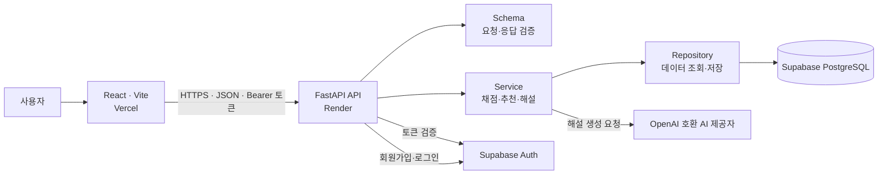

# TYPEUP 아키텍처

이 문서는 `origin/main` 기준 현재 구현을 설명한다. 배포 위치는 [README](../README.md#10-배포)에 기록된 구성을 따른다.

## 구성

React 화면은 [프런트엔드 API 클라이언트](../frontend/src/api/client.js)를 통해 FastAPI에 요청한다. FastAPI는 [라우터 등록과 CORS 설정](../backend/app/main.py)을 담당한다. 프런트엔드가 DB나 AI 제공자를 직접 호출하는 경로는 현재 구현에 없다.

| 계층 | 현재 역할 | 근거 |
| --- | --- | --- |
| API | 경로, HTTP 응답, 인증 의존성 및 접근 제어 | [API 라우터](../backend/app/api/), [토큰 검증](../backend/app/api/auth_dependencies.py) |
| Service | 채점, 학습 세션 처리, 추천 점수 계산, AI 해설 흐름 | [서비스](../backend/app/services/) |
| Repository | Supabase 테이블 조회·삽입·수정 및 사용자 소유 데이터 조회 | [저장소](../backend/app/repositories/), [Supabase 클라이언트](../backend/app/db/supabase.py) |
| Schema | Pydantic 요청·응답 형식과 필드 검증 | [스키마](../backend/app/schemas/) |

## 데이터 흐름

1. **인증:** React가 `/auth/signup` 또는 `/auth/login`을 호출한다. FastAPI의 [인증 서비스](../backend/app/services/auth_service.py)는 Supabase Auth 사용자와 DB의 `learners` 프로필을 연결한다. 로그인 응답의 Access Token은 [프런트엔드 인증 상태](../frontend/src/auth/authStore.js)에 저장되고 [API 클라이언트](../frontend/src/api/client.js)가 보호 요청에 Bearer 토큰으로 붙인다. [인증 의존성](../backend/app/api/auth_dependencies.py)은 Supabase Auth로 토큰을 검증하고 연결된 학습자를 조회한다.
2. **답안 채점·저장:** [진단 API](../backend/app/api/diagnostic.py)의 `/diagnostic/submit`은 인증된 답안을 받는다. [진단 서비스](../backend/app/services/diagnostic_service.py)는 서버에서 정답·오답 함정 데이터를 조회해 채점하고, [진단 저장소](../backend/app/repositories/diagnostic_repository.py)에 `diagnostic_sessions`와 `question_attempts`를 저장한다. 일반 학습도 [학습 서비스](../backend/app/services/learning_test_service.py)가 배정 문항을 확인한 뒤 채점하고 풀이 기록을 저장한다. 정답은 프런트엔드 문항 응답에 포함하지 않는다.
3. **취약 유형 추천:** 인증된 `/learning/recommendations`가 [추천 서비스](../backend/app/services/learning_recommendation_service.py)를 호출한다. [추천 저장소](../backend/app/repositories/learning_recommendation_repository.py)는 해당 학습자의 누적 `question_attempts`와 유형·함정 정보를 읽는다. 서비스는 세부 유형별 정답률, 최근 오답, 연속 오답, 반복 함정을 규칙으로 점수화해 최대 3개를 추천한다. 이 추천 계산에는 LLM을 사용하지 않는다.
4. **AI 해설:** `/ai/explanations/{attempt_id}`는 인증된 학습자에게만 열린다. [해설 서비스](../backend/app/services/ai_explanation_service.py)는 먼저 해당 풀이의 소유권과 `ai_explanations` 캐시를 확인한다. 캐시가 없으면 [검색 서비스](../backend/app/services/ai_retrieval_service.py)가 DB에서 근거를 모으고 [AI 클라이언트](../backend/app/clients/openai_client.py)가 OpenAI 호환 제공자에 전달한다. 응답은 스키마로 검증한 뒤 `attempt_id`별로 저장하고 반환한다.

## 검색, 학습 이력, 캐시

- **현재 RAG:** [해설 저장소](../backend/app/repositories/ai_explanation_repository.py)는 `attempt_id`에서 출발해 문제·선택지, 유형(`subtypes`·`types`), 문법 지식(`subtype_specs`), 오답 함정(`traps`)을 정확한 관계형 조회로 찾는다. 이 구조화된 컨텍스트를 프롬프트에 더해 해설을 생성한다. 임베딩이나 벡터 검색은 현재 사용하지 않는다.
- **학습 이력:** 진단·학습의 `question_attempts`를 DB에 누적하고 이후 로그인과 세션을 넘어 추천에 다시 사용한다. 여기서 장기 학습 이력은 별도 AI 메모리 서비스가 아니라 저장된 풀이 기록이다. [추천 구현](../backend/app/services/learning_recommendation_service.py).
- **해설 캐시:** 소유권 확인 후 `ai_explanations`에서 기존 해설을 읽는다. 새 해설은 검증 후 저장하며 동시 요청이 이미 저장한 결과가 있으면 그 캐시를 사용한다. [서비스](../backend/app/services/ai_explanation_service.py), [저장소](../backend/app/repositories/ai_explanation_repository.py).
- **향후 계획:** [README의 개선 항목](../README.md#14-현재-한계-및-향후-개선)에 있는 임베딩·Vector DB 검색, AI 학습 코치, AI 신규 문제 생성은 현재 구조에 포함되지 않는다.

## 배포와 설정

| 위치 | 역할 | 환경변수 이름 |
| --- | --- | --- |
| Vercel | React 정적 프런트엔드; Render API 호출 | `VITE_API_BASE_URL` |
| Render | FastAPI 실행; Supabase와 AI 제공자 호출 | `SUPABASE_URL`, `SUPABASE_SECRET_KEY`, `OPENAI_API_KEY`, `OPENAI_BASE_URL`, `OPENAI_MODEL`, `ALLOWED_ORIGINS` |
| Supabase | Auth 계정 및 PostgreSQL 학습 데이터·해설 캐시 | 이 저장소의 Supabase 배포용 환경변수 정의 없음 |

설정 이름은 [프런트엔드 예시](../frontend/.env.example), [백엔드 예시](../backend/.env.example), [설정 로더](../backend/app/core/config.py)를 따른다. `VITE_API_BASE_URL`은 배포된 API 주소, `ALLOWED_ORIGINS`는 허용할 프런트엔드 출처를 가리킨다. 비밀 키는 Render 서버 환경에만 설정하며 문서나 `VITE_` 변수에 넣지 않는다. [README](../README.md#12-결과)는 Vercel → Render → Supabase 연동 확인을 기록한다.
